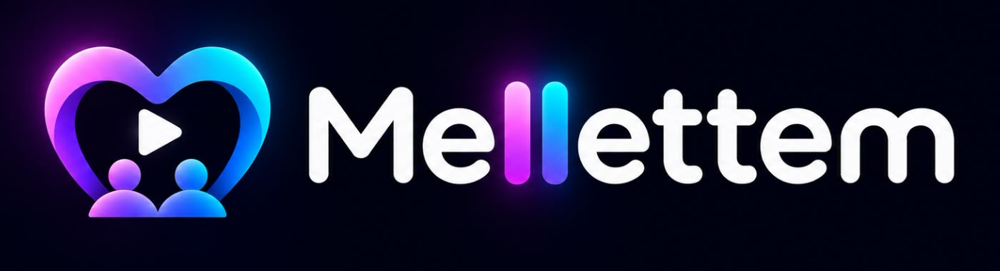
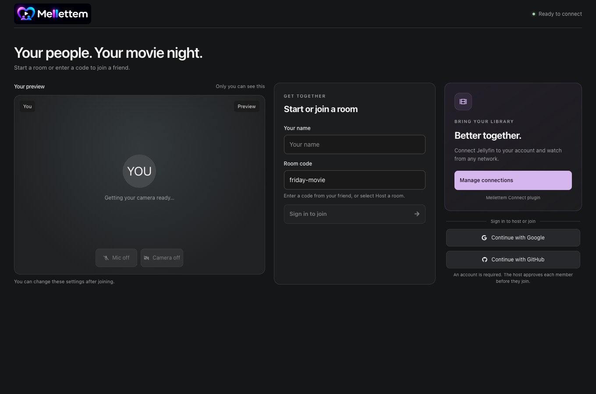
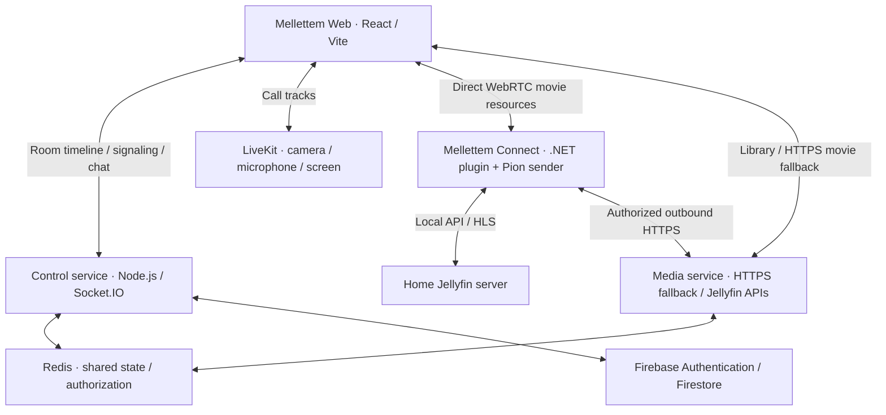

<h1 align="center">Mellettem</h1>

<hr />

<h3 align="center">Watch the same movie. Hear it your way.</h3>
<p align="center">Synchronized watch parties for your Jellyfin library and YouTube.</p>

<hr />

<p align="center">
  
</p>

<p align="center">
  <a href="https://github.com/devpratyushh/Samerow-V2/actions/workflows/ci.yml"></a>
  <a href="https://github.com/devpratyushh/Samerow-V2/actions/workflows/jellyfin-plugin.yml"></a>
  <a href="https://github.com/devpratyushh/Samerow-V2/releases"></a>
  <a href="jellyfin-plugin-mellettem/README.md"></a>
</p>

<p align="center">
  <a href="#quick-start">Quick start</a> ·
  <a href="https://samerow-v2.vercel.app/">Open Mellettem</a> ·
  <a href="jellyfin-plugin-mellettem/README.md">Get the Jellyfin plugin</a> ·
  <a href="docs/media-architecture.md">Documentation</a> ·
  <a href="https://github.com/devpratyushh/Samerow-V2/releases">Releases</a>
</p>

<hr />

Mellettem brings your people together around your movies. Start a private watch room, invite your friends, and enjoy a shared timeline with video calls and chat alongside the film. Play, pause, and seek stay synchronized while each person keeps their own viewing preferences.

Your Jellyfin server stays at home. **Mellettem Connect** links it to your account and makes your library available in Mellettem, so you can host a movie night from another device or network. Friends join in their browsers after the host approves them.

## Quick start

**Open Mellettem → Sign in → Start a room → Invite your friends.**

1. **Sign in.** Open [Mellettem Web](https://samerow-v2.vercel.app/) and continue with Google or GitHub.
2. **Bring your video.** YouTube is ready to share from a room. For Jellyfin, pair your server once with **Mellettem Connect** using the setup below.
3. **Start a room.** Enter your name and create a room. For Jellyfin, expand **Connect Jellyfin**, select **Generate private room code**, and enter the private room.
4. **Choose what to watch.** Open **Share something** and share a YouTube video, or select **Your Jellyfin library**, choose your connected server, and sign in to Jellyfin or use **Quick Connect** to pick a movie.
5. **Invite and watch.** Select **Invite friends**, send the full invitation link, and approve your friends' requests. Each viewer can choose their own available audio and subtitle tracks.

**Using your Jellyfin library?** Mellettem Connect is a Jellyfin server plugin that securely links your home library to your Mellettem account through an outbound connection. It needs no port forwarding or public Jellyfin address. Install it once, connect with Google, and your server is available from your account on other devices. Friends can join your room without installing the plugin.

- Requires **Jellyfin 12.3 / .NET 10**.
- The plugin supports direct movie delivery over WebRTC and HTTPS fallback where needed.
- Install from the [Mellettem Connect catalog](jellyfin-plugin-samerow/manifest.json), then pair it from Jellyfin's plugin settings.
- Follow the illustrated [Mellettem Connect installation guide](docs/mellettem-connect-installation.md) for repository setup, pairing, and troubleshooting.



*Start or join a room from the lobby, and manage your linked Jellyfin server through your account.*


## Same video, different audio tracks

**Watch together without having to agree on one language.** Each viewer chooses their own audio track from the same movie while everyone stays at the same point in the story. You can listen to the original Japanese audio while a friend chooses the English dub.

Subtitles work the same way: choose your own language, or turn them off. Audio, subtitles, volume, and quality are personal; the room's play, pause, and seek controls keep the shared experience in sync. Available languages depend on the tracks in your Jellyfin media.


*The movie, your friends, and the conversation share one room. Playback follows the room timeline while viewing preferences stay personal.*

## Native resolution over WebRTC, with HTTPS fallback

**Your library's picture quality belongs on movie night.** Original mode requests the source video at its native resolution, including 4K when the source, browser, device, and connection support it. Compatible video can be copied without re-encoding; Jellyfin can repackage the container or convert unsupported audio when needed.

Supported browsers receive movie resources directly from Mellettem Connect over **WebRTC**. If the browser or network cannot use that path, playback falls back to **HTTPS**. Both delivery paths support original-resolution playback when compatible; each viewer can also choose Auto or a bitrate limit to suit their connection. The active transport and playback details appear in **Stats for nerds**.

Native resolution depends on codec support and available bandwidth. Some subtitle formats need burn-in, and incompatible devices or lower quality settings can require transcoding. See the [playback and quality guide](docs/media-architecture.md) for details.

## No port forwarding. Linked to your Google account.

**Pair once and bring your library with you.** Install Mellettem Connect on Jellyfin, select **Connect Mellettem**, sign in with Google, and approve the connection. The plugin connects outbound, so you do not need to open router ports, expose Jellyfin publicly, or configure a reverse proxy for friends.

Sign into the same Mellettem account on another device to find your linked server. Authorize your Jellyfin user to browse the libraries that account can access, then invite friends into your room. Your home server and internet connection stay running during the party; the Jellyfin dashboard can be closed after pairing.

## More ways to spend time together

- **YouTube watch parties:** share a video and follow the same room timeline.
- **Video calls and screen sharing:** see and hear your friends while you watch.
- **Room chat:** keep the conversation beside the movie.
- **Private invitations and host approval:** decide who enters your room.
- **Reconnect recovery:** resume the room session after a connection interruption.
- **Playback diagnostics:** inspect transport, buffering, movie delivery, and call statistics.

The hosted Jellyfin release supports **one host and up to three friends**. Mellettem Connect is available as a **public beta**. See the [compatibility and rollout checks](docs/direct-media.md#validation) for browser and network coverage.

## Architecture

Mellettem separates room coordination, calls, and movie delivery. The Jellyfin plugin supervises a bundled Pion sender; supported browsers request their own HLS resources over an authorized WebRTC DataChannel. HTTPS remains available for incompatible browsers or restrictive networks.



| Component | Responsibility |
| --- | --- |
| React frontend on Vercel | Rooms, player, personal track preferences, call UI, and diagnostics |
| Node control service | Membership, approval, timeline, chat, and direct-media signaling |
| Node media service | Connector work, scoped library APIs, embedded Jellyfin Web, and HTTPS fallback |
| Redis | Shared state, encrypted credentials, authorization leases, and distributed limits |
| Firebase | Account authentication and persistent chat storage |
| LiveKit | Camera, microphone, and screen media |
| Jellyfin plugin and Go sender | Local Jellyfin access and direct HLS resource delivery |

The deployment blueprint configures two control instances and one media instance. Multiple media replicas need connector routing before enabling them. LiveKit calls and Jellyfin movie delivery use separate transports.

[Movie delivery and quality](docs/media-architecture.md) · [Direct transport, fallback, and rollout](docs/direct-media.md) · [Production runbook](docs/production.md)

## Playback and capacity

| Control | Behavior |
| --- | --- |
| Play / pause / seek | Shared by the room |
| Audio / subtitles / volume | Personal to each viewer |
| Original | Requests source video stream-copy when supported; remuxing or audio conversion may still be needed |
| Auto | Uses compatible playback and adapts to connection conditions |
| 4 / 8 / 20 Mbps | Caps that viewer's requested bitrate; Jellyfin may transcode |

Each viewer receives a separate stream. Four viewers at 8 Mbps require approximately **32 Mbps of home upload**, plus headroom for peaks, retries, and calls. Direct delivery avoids gateway movie bandwidth for that viewer; it does not remove home upload requirements. Jellyfin handles remuxing and transcoding.

**More options → Stats for nerds** shows the selected movie transport, fallback reason, delivery and playback metrics, and call statistics. Codec, HDR, subtitle burn-in, and device support depend on the source, Jellyfin configuration, and browser. Native HLS uses HTTPS. Restrictive NATs may require HTTPS because direct movie delivery has no TURN dependency.

## Develop locally

Use **Node.js 24** and npm. Install and start the backend:

```sh
npm --prefix SameRow/server ci
npm --prefix SameRow/server start
```

In another terminal:

```sh
npm --prefix SameRow/client ci
npm --prefix SameRow/client run dev
```

Vite proxies to the backend on port 3000. See the [client configuration](SameRow/client/.env.example) and [server configuration](SameRow/server/.env.example). Keep credentials outside Git and browser-facing `VITE_*` variables. `/ui-preview?scene=lobby` provides a sample-data preview.

Build the plugin with .NET 10 and Jellyfin 12.3 reference assemblies. Its bundled sender uses Go; [plugin build and packaging instructions](jellyfin-plugin-mellettem/README.md) and the [release workflow](.github/workflows/jellyfin-plugin.yml) describe all platform binaries and dependency notices.

## Verify and deploy

```sh
npm --prefix SameRow/server test
npm --prefix SameRow/client test
npm --prefix SameRow/client run lint
npm --prefix SameRow/client run build
```

Set `TEST_REDIS_URL` to a disposable Redis instance to include shared-state checks. [Application CI](.github/workflows/ci.yml) also exercises reconnects, direct HLS, and HTTPS fallback. [Plugin CI](.github/workflows/jellyfin-plugin.yml) builds and tests the plugin and packages senders for Linux, macOS, and Windows on amd64 and arm64.

Deploy matching frontend and backend revisions using the [production runbook](docs/production.md). Production requires Firebase, LiveKit, Redis, HTTPS origins, and a persistent encryption key. Readiness endpoints and the frontend deployment check validate the configured services before publication.

Local integration covers real Jellyfin media, direct delivery, byte ranges, tracks, synchronization, and simulated fallback. Hosted approval and playback across separate networks, physical iOS, high-bitrate HDR, and regular desktop Firefox still need the acceptance checks in the [direct-media guide](docs/direct-media.md#validation). See the [integration report](jellyfin-plugin-mellettem/test-results/README.md) for the scope of earlier runs.

## Project guide

| Path | Contents |
| --- | --- |
| `SameRow/client` | Web application and browser checks |
| `SameRow/server` | Control and media services |
| `jellyfin-plugin-mellettem` | Jellyfin plugin, sender, packaging, and license |
| `jellyfin-plugin-samerow/manifest.json` | Stable catalog address used by installed servers |
| `docs` | Architecture, deployment, and brand assets |

## Support and licensing

[Report a bug](https://github.com/devpratyushh/Samerow-V2/issues/new?template=bug_report.yml) with your browser, plugin version, chosen transport, and reproduction steps. Omit credentials, private invitation links, and personal media URLs. See [security reporting](SECURITY.md) for private reports.

The web application and backend are [All Rights Reserved](LICENSE). Mellettem Connect and its build/test files are [GPL-3.0-or-later](jellyfin-plugin-mellettem/LICENSE); see the [licensing scope](jellyfin-plugin-mellettem/LICENSING.md). Brand assets are supplied for identifying Mellettem and do not change the software licenses.
