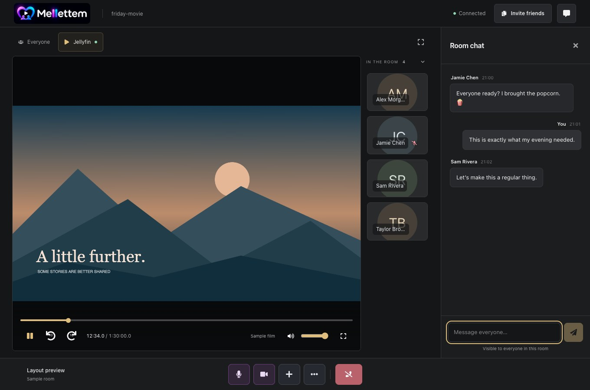
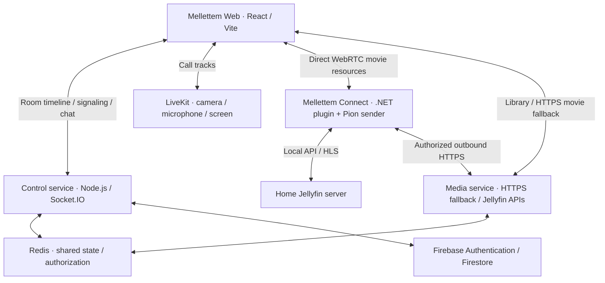

<p align="center">
  
</p>

<p align="center"><strong>Your people. Your movies. One shared moment.</strong></p>
<p align="center">Watch Jellyfin and YouTube together with synchronized playback, video calls, screen sharing, and chat.</p>
<p align="center">
  <a href="https://samerow-v2.vercel.app/">Open Mellettem</a> ·
  <a href="jellyfin-plugin-mellettem/README.md">Install Mellettem Connect</a> ·
  <a href="docs/media-architecture.md">Architecture</a> ·
  <a href="docs/production.md">Deployment</a> ·
  <a href="https://github.com/devpratyushh/Samerow-V2/issues">Report an issue</a>
</p>
<p align="center">
  <a href="https://github.com/devpratyushh/Samerow-V2/actions/workflows/ci.yml"></a>
  <a href="https://github.com/devpratyushh/Samerow-V2/actions/workflows/jellyfin-plugin.yml"></a>
  <a href="https://github.com/devpratyushh/Samerow-V2/releases"></a>
</p>



## A watch party that feels together

- **One shared timeline.** Play, pause, and seek stay in sync across the room.
- **Your own viewing preferences.** Choose audio language, subtitles, volume, and movie quality independently.
- **Your home library, wherever friends are.** Mellettem Connect pairs Jellyfin to your account without port forwarding.
- **Direct movie delivery.** Supported browsers receive HLS resources from your Jellyfin plugin over WebRTC, with HTTPS fallback when needed.
- **Talk while you watch.** LiveKit carries camera, microphone, and screen sharing; room chat stays alongside the movie.
- **Private by invitation.** Sign in with Google or GitHub. The host approves each member before room content or calls become accessible.
- **Pick up again.** Account-linked servers, remembered Jellyfin accounts, reconnect recovery, and playback diagnostics help keep the party going.

The hosted Jellyfin release supports **one host and up to three friends**. The plugin is distributed as a **public beta**; browser and network limits are documented below.

## Start watching

1. Open [Mellettem Web](https://samerow-v2.vercel.app/) and sign in.
2. Create a room. For your Jellyfin library, expand **Connect Jellyfin**, generate a private room code, and enter the room.
3. Choose **Share something → Your Jellyfin library** or share a YouTube video.
4. Select **Invite friends** and share the full invitation link.
5. Approve your friends' requests and watch together.

For Jellyfin, pair your server once using the plugin installation below. Sign into the same Mellettem account on another device to discover your connected server. Jellyfin permissions still determine library access.

## Install Mellettem Connect

Requires **Jellyfin 12.3 / .NET 10**. In Jellyfin, open **Dashboard → Plugins → Repositories** and add:

```text
https://raw.githubusercontent.com/devpratyushh/Samerow-V2/main/jellyfin-plugin-samerow/manifest.json
```

1. Install **Mellettem Connect** from **Catalog** and restart Jellyfin.
2. Open its plugin settings and select **Connect Mellettem**.
3. Sign in to Mellettem, approve the connection, and wait for **Connected** in Jellyfin.
4. In your room, select the connected server and authorize your Jellyfin user, or use **Quick Connect**.

Keep your Jellyfin server and internet connection running during the party. You can close the Jellyfin dashboard after pairing.

[Plugin downloads](https://github.com/devpratyushh/Samerow-V2/releases) · [Full installation, updates, and recovery guide](jellyfin-plugin-mellettem/README.md)

This repository supplies a third-party Jellyfin catalog. It does not imply inclusion in Jellyfin's default catalog.

## Architecture

Mellettem separates room coordination, calls, and movie delivery. The Jellyfin plugin supervises a bundled Pion sender; supported browsers request their own HLS resources over an authorized WebRTC DataChannel. HTTPS remains available for incompatible browsers or restrictive networks.



| Component | Responsibility |
| --- | --- |
| React frontend on Vercel | Rooms, player, personal track preferences, call UI, and diagnostics |
| Node control service | Membership, approval, timeline, chat, and direct-media signaling |
| Node media service | Connector work, scoped library APIs, embedded Jellyfin Web, and HTTPS fallback |
| Redis | Shared state, encrypted credentials, authorization leases, and distributed limits |
| Firebase | Account authentication and persistent chat storage |
| LiveKit | Camera, microphone, and screen media |
| Jellyfin plugin and Go sender | Local Jellyfin access and direct HLS resource delivery |

The deployment blueprint configures two control instances and one media instance. Multiple media replicas need connector routing before enabling them. LiveKit calls and Jellyfin movie delivery use separate transports.

[Movie delivery and quality](docs/media-architecture.md) · [Direct transport, fallback, and rollout](docs/direct-media.md) · [Production runbook](docs/production.md)

## Playback and capacity

| Control | Behavior |
| --- | --- |
| Play / pause / seek | Shared by the room |
| Audio / subtitles / volume | Personal to each viewer |
| Original | Requests source video stream-copy when supported; remuxing or audio conversion may still be needed |
| Auto | Uses compatible playback and adapts to connection conditions |
| 4 / 8 / 20 Mbps | Caps that viewer's requested bitrate; Jellyfin may transcode |

Each viewer receives a separate stream. Four viewers at 8 Mbps require approximately **32 Mbps of home upload**, plus headroom for peaks, retries, and calls. Direct delivery avoids gateway movie bandwidth for that viewer; it does not remove home upload requirements. Jellyfin handles remuxing and transcoding.

**More options → Stats for nerds** shows the selected movie transport, fallback reason, delivery and playback metrics, and call statistics. Codec, HDR, subtitle burn-in, and device support depend on the source, Jellyfin configuration, and browser. Native HLS uses HTTPS. Restrictive NATs may require HTTPS because direct movie delivery has no TURN dependency.

## Develop locally

Use **Node.js 24** and npm. Install and start the backend:

```sh
npm --prefix SameRow/server ci
npm --prefix SameRow/server start
```

In another terminal:

```sh
npm --prefix SameRow/client ci
npm --prefix SameRow/client run dev
```

Vite proxies to the backend on port 3000. See the [client configuration](SameRow/client/.env.example) and [server configuration](SameRow/server/.env.example). Keep credentials outside Git and browser-facing `VITE_*` variables. `/ui-preview?scene=lobby` provides a sample-data preview.

Build the plugin with .NET 10 and Jellyfin 12.3 reference assemblies. Its bundled sender uses Go; [plugin build and packaging instructions](jellyfin-plugin-mellettem/README.md) and the [release workflow](.github/workflows/jellyfin-plugin.yml) describe all platform binaries and dependency notices.

## Verify and deploy

```sh
npm --prefix SameRow/server test
npm --prefix SameRow/client test
npm --prefix SameRow/client run lint
npm --prefix SameRow/client run build
```

Set `TEST_REDIS_URL` to a disposable Redis instance to include shared-state checks. [Application CI](.github/workflows/ci.yml) also exercises reconnects, direct HLS, and HTTPS fallback. [Plugin CI](.github/workflows/jellyfin-plugin.yml) builds and tests the plugin and packages senders for Linux, macOS, and Windows on amd64 and arm64.

Deploy matching frontend and backend revisions using the [production runbook](docs/production.md). Production requires Firebase, LiveKit, Redis, HTTPS origins, and a persistent encryption key. Readiness endpoints and the frontend deployment check validate the configured services before publication.

Local integration covers real Jellyfin media, direct delivery, byte ranges, tracks, synchronization, and simulated fallback. Hosted approval and playback across separate networks, physical iOS, high-bitrate HDR, and regular desktop Firefox still need the acceptance checks in the [direct-media guide](docs/direct-media.md#validation). See the [integration report](jellyfin-plugin-mellettem/test-results/README.md) for the scope of earlier runs.

## Project guide

| Path | Contents |
| --- | --- |
| `SameRow/client` | Web application and browser checks |
| `SameRow/server` | Control and media services |
| `jellyfin-plugin-mellettem` | Jellyfin plugin, sender, packaging, and license |
| `jellyfin-plugin-samerow/manifest.json` | Stable catalog address used by installed servers |
| `docs` | Architecture, deployment, and brand assets |

## Support and licensing

[Report a bug](https://github.com/devpratyushh/Samerow-V2/issues/new?template=bug_report.yml) with your browser, plugin version, chosen transport, and reproduction steps. Omit credentials, private invitation links, and personal media URLs. See [security reporting](SECURITY.md) for private reports.

The web application and backend are [All Rights Reserved](LICENSE). Mellettem Connect and its build/test files are [GPL-3.0-or-later](jellyfin-plugin-mellettem/LICENSE); see the [licensing scope](jellyfin-plugin-mellettem/LICENSING.md). Brand assets are supplied for identifying Mellettem and do not change the software licenses.
