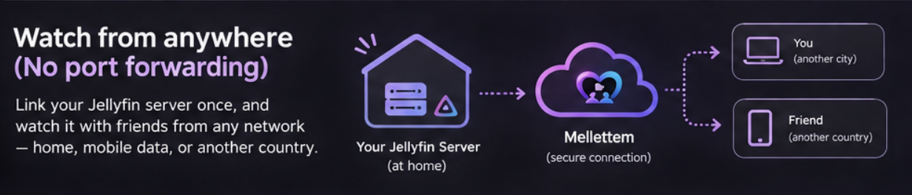
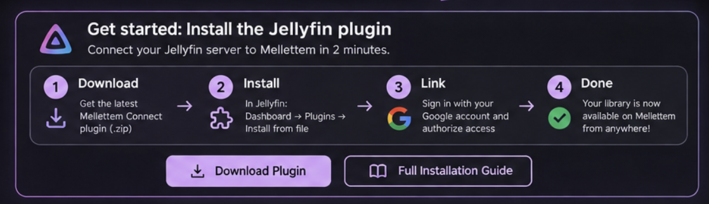

# Mellettem

**Watch your Jellyfin library remotely with friends. Share playback in your browsers, pick your own audio and subtitles, and skip port forwarding.**

[Open Mellettem](https://samerow-v2.vercel.app/) · [Plugin releases](https://github.com/devpratyushh/Samerow-V2/releases)

## Install the Jellyfin plugin

Mellettem Connect is in public beta for **Jellyfin 12.3 / .NET 10**. The plugin connects your Jellyfin server to Mellettem over an outbound HTTPS connection, so you and up to three friends can watch from different networks without port forwarding.

[](docs/images/watch-from-anywhere.png)

1. In Jellyfin, open **Dashboard → Plugins → Repositories**. Add **Mellettem Connect** with this catalog URL:

   ```text
   https://raw.githubusercontent.com/devpratyushh/Samerow-V2/main/jellyfin-plugin-samerow/manifest.json
   ```

2. Open **Catalog**, install **Mellettem Connect**, and restart Jellyfin.
3. Open **Dashboard → Plugins → Mellettem Connect**. Select **Connect Mellettem**, open the approval link, and approve with your Google account. Jellyfin will show **Connected**.

**No port forwarding.** The plugin connects outbound over HTTPS. Keep Jellyfin running during the watch party.

[](docs/images/install-plugin-steps.png)

[Full installation guide and troubleshooting](docs/mellettem-connect-installation.md) · [Plugin dashboard preview](docs/screenshots/mellettem-connect-dashboard.png)

## Watch your Jellyfin library with friends

1. Sign in with the Google account you used to pair, enter your name, and select **Host a room**. [Open Mellettem](https://samerow-v2.vercel.app/)
2. Choose **Share something → Your Jellyfin library**. Pick your server, sign in to Jellyfin or use **Quick Connect**, and select a movie.
3. Use **Invite friends** to share the room link. Approve join requests as they arrive.

The hosted beta supports **one host and up to three friends**. Everyone joins in their browser, with synchronized playback, video calls, and chat. Only the host's Jellyfin server needs the plugin.

[](docs/images/watch-room.jpg)

## Same moment, your own audio and subtitles

Play, pause, and seek stay in sync. Each viewer picks their own available audio and subtitle tracks.

[](docs/images/independent-tracks.jpg)

*Playback mockup showing two viewers at the same moment with different tracks.*

## Docs and support

[Playback and quality](docs/media-architecture.md) · [WebRTC and HTTPS fallback](docs/direct-media.md) · [Deployment](docs/production.md) · [Plugin development](jellyfin-plugin-mellettem/README.md) · [Report a bug](https://github.com/devpratyushh/Samerow-V2/issues/new?template=bug_report.yml) · [Security](SECURITY.md)

<details>
<summary>Run locally and verify</summary>

Use Node.js 24. Start the backend:

```sh
npm --prefix SameRow/server ci
npm --prefix SameRow/server start
```

In another terminal:

```sh
npm --prefix SameRow/client ci
npm --prefix SameRow/client run dev
```

Vite proxies to the backend on port 3000. See the [client config](SameRow/client/.env.example) and [server config](SameRow/server/.env.example). Open `/ui-preview?scene=jellyfin` for a sample watch room.

```sh
npm --prefix SameRow/server test
npm --prefix SameRow/client test
npm --prefix SameRow/client run lint
npm --prefix SameRow/client run build
```

[Application CI](.github/workflows/ci.yml) · [Plugin CI](.github/workflows/jellyfin-plugin.yml) · [Integration results](jellyfin-plugin-mellettem/test-results/README.md)

</details>

Rooms also support screen sharing and synchronized YouTube playback.

The web app and backend are [All Rights Reserved](LICENSE). Mellettem Connect is [GPL-3.0-or-later](jellyfin-plugin-mellettem/LICENSE).
