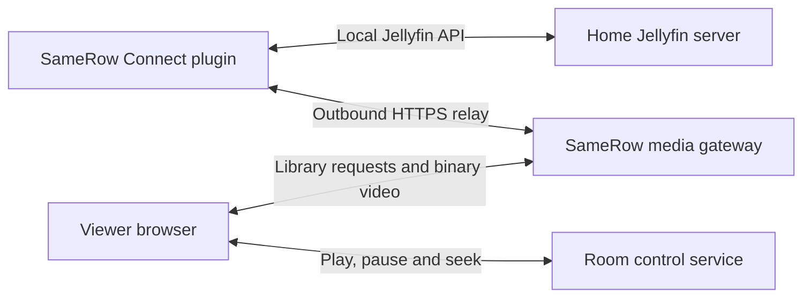

# SameRow

Watch movies and YouTube together while you talk and share your screen.
Play, pause, and seek follow the room. Everyone chooses their own volume,
and Jellyfin viewers can choose their own audio language, subtitles, and quality.


## Host from your home Jellyfin server

**Install the plugin → Pair your server → Open SameRow → Watch together.**

SameRow Connect is a native Jellyfin server plugin. It lets your home server
deliver movies to a hosted SameRow room through an outbound HTTPS connection.
Your friends join from their browsers.

### Set it up once

1. Install **SameRow Connect** on your Jellyfin server and restart Jellyfin.
2. Open **Dashboard → Plugins → SameRow Connect** and select **Connect SameRow**.
3. Sign in to SameRow Web with Google and approve the connection.
4. Return to Jellyfin's plugin settings and wait for **Connected**.

The public beta targets **Jellyfin 12.3 and .NET 10**. Add this third-party repository in **Dashboard → Plugins → Repositories**, install **SameRow Connect** from **Catalog**, and restart Jellyfin:

```text
https://raw.githubusercontent.com/devpratyushh/Samerow-V2/main/jellyfin-plugin-samerow/manifest.json
```

[Download the plugin and source](https://github.com/devpratyushh/Samerow-V2/releases/tag/samerow-connect-v1.0.2.0) or follow the [installation and compatibility guide](jellyfin-plugin-samerow/README.md). This is SameRow's repository; acceptance into Jellyfin's default catalog or community directory is separate.

### Start a watch party

1. Open [SameRow Web](https://samerow-v2.vercel.app/).
2. Expand **Connect Jellyfin** and select **Generate private room code**.
3. Enter your name and join the private room.
4. Open **Share something → Your Jellyfin library** and select your connected server.
5. Sign in to Jellyfin or use **Quick Connect**. You can remember the connection.
6. Browse your library and select a movie.
7. Use **Invite friends** and send the full invitation link.

Friends open the invitation, sign in with Google or GitHub, and request to join.
The host must approve each member before they can access room content
or calls. Anonymous guest access is disabled. Leaving and joining again requires
fresh approval; reconnecting after a network interruption retains approval.
The hosted Jellyfin pilot supports **one host and up to three members**. Members
can join with their camera and microphone off and receive access to the selected
movie through the room.

Your home server, Jellyfin, and internet connection must stay running during
the party. Once pairing is complete, you can close Jellyfin's dashboard.

### Audio, subtitles, and quality

| Setting | What happens |
| --- | --- |
| Play, pause, and seek | Everyone follows the shared timeline. |
| Audio language | Each viewer selects a track from the movie. |
| Subtitles | Each viewer selects their own subtitles or turns them off. |
| Volume and mute | Each viewer controls their own sound. |
| Original | Copies the source video when the device, selected tracks, and available bandwidth permit it. |
| Auto | Uses compatible playback and adjusts to connection conditions. |
| Manual quality | Caps bitrate on that device at 4, 8, or 20 Mbps. Jellyfin may convert the video. |

One viewer can use Japanese audio with English subtitles while another uses
the English dub. Text subtitles are displayed over the picture. Subtitles
that need to be burned into the picture require video conversion for the
viewer who selects them. Unsupported audio can be converted independently
while the video stays original.

Original playback sends binary media through the gateway and feeds compatible
segments into the browser's Media Source Extensions player. When a container
needs repackaging, Jellyfin can remux the video without re-encoding it.
SameRow reports when it switches to compatible playback. The track menu also
offers the embedded **Jellyfin Web player**.

HDR and particular audio formats depend on the source, browser, and device.
HDR acceptance testing is still pending.

## How the plugin connects

The plugin maintains authenticated outbound HTTPS requests to SameRow's media
gateway. The gateway returns library or playback work through that connection.
The plugin calls Jellyfin's local API and streams each response back to the gateway,
which delivers it to the viewer.



Pairing links the server to the owner's SameRow account. The plugin stores an
encrypted connector credential and reconnects after interruptions. Media
access is scoped to the room, selected item, and current viewer membership.
Guests receive playback access without receiving the owner's upstream credential.

### Upload and room capacity

Media is relayed separately to each viewer. Four viewers streaming at 8 Mbps
can use roughly **32 Mbps of home upload**, plus headroom for bitrate peaks and
calls. Original-quality sources can require substantially more bandwidth.

The hosted pilot currently uses four participants per room and **one media
replica**. Control services share state through Redis. Multiple media replicas
need explicit connector routing before they can be enabled.

## Stats for nerds and local video quality

In a room, open **More options → Stats for nerds**. While open, it refreshes
call upload/download, each peer’s bitrate, resolution, FPS, codec, packet loss,
jitter and available encoder/RTT information every five seconds. Unsupported
browser metrics appear as unavailable. Call stats describe this device’s links;
in hosted rooms, upload goes to LiveKit and received tracks come from LiveKit.

For Jellyfin, the panel shows media delivered to each current room member and
their reported decoded resolution, buffered seconds, and dropped/total frames.
Delivery is measured at the gateway, includes prefetch/retries, and is separate
from the encoded movie bitrate. The first sample measures a baseline; a fully
buffered viewer can receive zero bytes while playback continues. Viewer reports
expire after 20 seconds without updates. Only current room members can request
these stats. Credentials, upstream addresses and access tokens are excluded.

## Supported setup

Use [SameRow Connect](jellyfin-plugin-samerow/README.md) for a home Jellyfin
library. Open SameRow Web for watch rooms, calls, and screen sharing.
See [hosted deployment](docs/production.md) or [local development](#local-development)
when running the application from source.

## Join a room

Open the invitation link, enter your name, and select **Enter room**.
Public rooms also accept a room code. Private rooms require the full invitation.
The lobby generates a four-letter code when you start a room.


## Architecture

Read the [movie delivery and quality guide](docs/media-architecture.md) for public
Jellyfin and plugin paths, the media gateway, four-viewer bandwidth, quality
selection, synchronization, and local blur troubleshooting.

Clients correct playback drift locally. Rejoining tabs refresh their room
access and can reclaim a seat in a full room. Movie delivery uses the media
gateway, and call tracks use LiveKit.

## Local development

Use **Node.js 24** and npm. From the repository root, start the backend:

```sh
npm --prefix SameRow/server ci
npm --prefix SameRow/server start
```

In another terminal, start the frontend:

```sh
npm --prefix SameRow/client ci
npm --prefix SameRow/client run dev
```

Open the URL printed by Vite. Its development proxy targets the backend on
port 3000. If your backend uses another address, set `VITE_SOCKET_URL`.
For a UI preview with sample data, open `/ui-preview?scene=lobby`.

Configuration examples are in
[client/.env.example](SameRow/client/.env.example) and
[server/.env.example](SameRow/server/.env.example).
Store server credentials and connector secrets outside Git and client-side
`VITE_*` variables.

### Build the Jellyfin plugin

Use the **.NET 10 SDK** and a Jellyfin 12.3 server installation containing the
reference assemblies:

```sh
dotnet build jellyfin-plugin-samerow/SameRow.Plugin.csproj \
  -c Release -p:JellyfinServerPath=/absolute/path/to/jellyfin

python3 jellyfin-plugin-samerow/package.py
```

The ZIP and SHA-256 checksum are written to `jellyfin-plugin-samerow/dist/`.
The [plugin guide](jellyfin-plugin-samerow/README.md) covers installation,
credential backup, rotation, updates, troubleshooting, and uninstallation.

## Deployment

Deploy matching frontend and backend revisions before using the plugin with
the hosted service.

Follow the [production runbook](docs/production.md) for Firebase, LiveKit,
Redis, origins, readiness, and deployment recovery.

## Verification

The latest local run passed:

- **88 JavaScript tests** with real Redis and no skips.
- **10 C# plugin tests**, frontend lint, and production builds.
- Four browsers decoding a **generated 3840×2160 clip** through the real C#
  connector service, real Jellyfin server, and SameRow gateway.
- Exact HTTP 206 byte-range comparisons, personal audio/subtitles, shared
  seeking, reconnects, and Jellyfin video stream-copy confirmation.
- A failover probe that recovered **20 of 20 users** across two control instances.

The C# integration test uses a local host adapter, development identities, and
loopback HTTP. Full acceptance with an installed plugin, hosted HTTPS/Google
approval, and guests on separate networks remains pending. High-bitrate HDR
and every browser/codec combination are also outside the completed test run.

Read the [verification report](jellyfin-plugin-samerow/test-results/README.md)
for results, fixes, commands, and remaining limits.

### Run checks

```sh
npm --prefix SameRow/server test
npm --prefix SameRow/client test
npm --prefix SameRow/client run lint
npm --prefix SameRow/client run build
```

Set `TEST_REDIS_URL` to disposable local Redis to include the shared-state checks:

```sh
TEST_REDIS_URL=redis://127.0.0.1:6379 npm --prefix SameRow/server test
TEST_REDIS_URL=redis://127.0.0.1:6379 npm --prefix SameRow/server run test:reconnect
```

For plugin tests:

```sh
JELLYFIN_SERVER_PATH=/absolute/path/to/jellyfin \
  dotnet run --project jellyfin-plugin-samerow.tests \
  -c Release -p:JellyfinServerPath=/absolute/path/to/jellyfin
```

See the [client browser checks](SameRow/client/README.md#checks) and
[plugin integration guide](jellyfin-plugin-samerow/README.md#verification-and-distribution)
for the browser/runtime prerequisites and disposable Jellyfin fixture.

[Application CI](.github/workflows/ci.yml) runs Node checks and Redis recovery.
[Plugin CI](.github/workflows/jellyfin-plugin.yml) builds, tests, validates,
and uploads the plugin artifact.

## Repository layout

## License and release status

The SameRow web application and backend use an [All Rights Reserved license](LICENSE). **SameRow Connect and its build/test files are GPL-3.0-or-later**; see the [plugin license](jellyfin-plugin-samerow/LICENSE) and [scope](jellyfin-plugin-samerow/LICENSING.md).

The plugin is a public beta for Jellyfin 12.3. Local and CI verification passed; full hosted approval and playback across separate networks with three guests still require acceptance testing. The published catalog points to a verified GitHub Release ZIP and its matching source.

## Jellyfin availability and saved accounts

Use the SameRow Connect Jellyfin plugin to pair your server, then authorize your
Jellyfin user with your signed-in SameRow account. Sign into the same account on
another device to restore the library, including from another network.

The dashboard distinguishes Ready, Offline, Reconnecting, Sign-in required,
Jellyfin unavailable, and Status unavailable. It shows each server and Jellyfin
user, the bound account, and when the server was last reached. Set a default if
you have multiple servers. Binding survives shutdowns and inactivity; explicitly
disconnect it to remove access. Lost device connectivity does not mark the home
server offline. Playback retains the room timeline while reconnecting.
