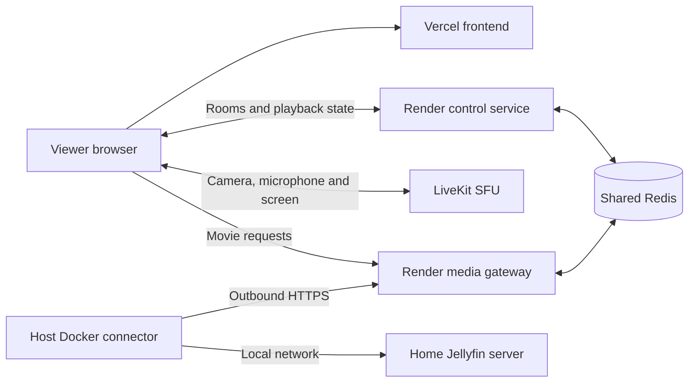

# SameRow

Watch a movie or YouTube video with friends while you talk, chat, or share your
screen. SameRow keeps playback in sync, so when someone pauses or skips ahead,
everyone follows. Each person can adjust their own volume, and Jellyfin viewers
can choose their own audio and subtitles.

## Install SameRow on your server with Docker

Use a home server or NAS that can reach your Jellyfin library. The commands
below run **on that server**. If you're using a different computer, connect
to the server over SSH first. You'll need Git, Docker Engine, and Docker
Compose. [Docker installation instructions](https://docs.docker.com/engine/install/)

### 1. Download SameRow

```sh
docker compose version
git clone https://github.com/devpratyushh/Samerow-V2.git
cd Samerow-V2
```

### 2. Set your server and Jellyfin addresses

Create `.env.local-docker` in the folder you just cloned. Replace
`192.168.1.20` with the **SameRow server's LAN IP** and `192.168.1.50`
with the **Jellyfin server's LAN IP**. Use the actual Jellyfin port if it
differs from `8096`.

```dotenv
SAMEROW_BIND_IP=192.168.1.20
SAMEROW_ORIGINS=http://192.168.1.20:8080
JELLYFIN_ALLOWED_ORIGINS=http://192.168.1.50:8096
```

If Jellyfin is on the same server as Docker, you can use
`http://host.docker.internal:8096` for the Jellyfin address, provided
Jellyfin listens on an interface the container can reach.

### 3. Start SameRow and open it

```sh
docker compose --env-file .env.local-docker -f compose.local.yaml up --build -d
docker compose --env-file .env.local-docker -f compose.local.yaml ps
```

From your phone or computer on the same network, open
`http://192.168.1.20:8080` using your **SameRow server's** IP. Enter your
name, use the room code that SameRow fills in, and select **Enter room**.
Choose **Share something → Your Jellyfin library** and sign in to Jellyfin.
Use the room's invite button to bring in up to three guests.

**[Read the full Docker guide →](docs/local-edition.md)** for alternate network
setups, updates, and troubleshooting. For guests outside your home network,
follow the [hosted Jellyfin pilot](docs/jellyfin-pilot.md).


## Join a room

Open the invite link, enter your name, and select **Enter room**. If someone
shared a public room code, enter it in the lobby. Private rooms need the
full link. You can join with your camera and microphone off.

For a Jellyfin movie, only the person sharing it needs a Jellyfin account.
The hosted pilot fits **one host and up to three guests**. If the room is
full, try again once someone leaves.


## Host a watch party

1. Open SameRow and enter your name. The lobby fills in a random four-character
   room code. You can generate another code or type one of your own.
2. Select **Enter room** and use the invite button to share the room link.
3. Open **Share something** to start a YouTube video, share your screen, or
   browse your Jellyfin library. When you're done, stop sharing from the room.

If your Jellyfin library is at home and your guests will join from the web,
pair your Docker container once, then use **Generate private room code** in
the Docker hosting panel. Start with **Auto** quality and invite one guest
first. The [pilot walkthrough](docs/jellyfin-pilot.md) shows the host and guest
steps, then covers pairing and deployment.

## Choose how to run SameRow

| What you want to do | Setup |
| --- | --- |
| Watch YouTube and call friends from different networks | Run the [hosted edition](docs/production.md). |
| Watch from Jellyfin at home, on devices on the same network | Run [SameRow Local](docs/local-edition.md) alongside your library with Docker Compose. |
| Share a home Jellyfin library with friends on the regular SameRow website | Use the [hosted Jellyfin pilot](docs/jellyfin-pilot.md). Only the host runs Docker. |
| Change the code or run tests | Start with [local development](#local-development). |

## Technical overview

SameRow separates room coordination, calls, and movie delivery. Room coordination
runs through Socket.IO. The hosted edition uses a LiveKit SFU for camera,
microphone, and screen tracks. The local edition uses a small WebRTC peer mesh.
YouTube viewers load video from YouTube and receive playback state from SameRow.



| Component | Role |
| --- | --- |
| React and Vite | Lobby, room UI, shared player controls, chat, and media layout |
| Node.js, Express, and Socket.IO | Authenticated room admission, signaling, chat, and playback synchronization |
| Redis | Shared room state, membership leases, rate limits, and encrypted Jellyfin connection state across hosted services |
| Firebase | Hosted Google and guest authentication, with Firestore for chat history |
| LiveKit | Hosted WebRTC forwarding and TURN connectivity |
| Jellyfin media gateway | Video access scoped to the selected item and current room membership |

### Playback and recovery

- **YouTube.** The server tracks the shared timeline. Clients estimate their
  offset using acknowledged server timestamps and correct drift locally.
- **Jellyfin.** The owner signs in with a Jellyfin account or Quick Connect.
  The room embeds Jellyfin Web through the media gateway. Play, pause, and
  seek are shared. Audio tracks, subtitles, volume, and quality are personal.
  Viewers receive scoped playback access, and the owner's upstream credential
  stays server-side.
- **Reconnection.** Room admission must succeed before media starts. Clients
  retry transient failures and refresh their session. A reconnecting tab can
  reclaim its seat in a full room. The LiveKit connection can recover
  independently and restore active local tracks, including a screen share.

### Jellyfin routing and capacity

For LAN viewing, SameRow Local serves the UI and media gateway from the same
address. The container contacts Jellyfin directly. For hosted playback, Render
can connect to a reachable HTTPS Jellyfin origin, or the host can pair a
Docker connector that reaches their LAN library. The connector uses outbound
HTTPS and needs no inbound router port. Guest browsers request media from
SameRow's gateway, so Jellyfin's CORS configuration can stay as it is.

The pilot relays media per viewer. Four viewers at 8 Mbps each can require
about 32 Mbps of upload from the host. Shared movie segment delivery is future
work. The hosted pilot allows four participants per room, and the relay
currently runs on a single media replica. LiveKit call traffic follows a
separate path from Jellyfin movie traffic.

## Local development

Use **Node.js 24** and npm. From the repository root, start the backend in
one terminal:

```sh
npm --prefix SameRow/server ci
npm --prefix SameRow/server start
```

In another terminal, install and start the web client:

```sh
npm --prefix SameRow/client ci
npm --prefix SameRow/client run dev
```

Open the URL printed by Vite. By default the development client uses Vite's
proxy to the backend on port 3000 and the local backend accepts development
guests. If you run the backend on a different port, point `VITE_SOCKET_URL`
at its address. For a UI-only preview with sample data, open
`/ui-preview?scene=lobby` on Vite.

See the [client environment example](SameRow/client/.env.example) and the
[server environment example](SameRow/server/.env.example) for configuration.
Keep private keys, service account credentials, and connector tokens out of
Git and out of `VITE_*` variables.

## Docker and hosted deployment

- **SameRow Local.** [Dockerfile.local](Dockerfile.local) builds the web UI and
  Node service in one image. [compose.local.yaml](compose.local.yaml) binds
  to loopback by default and stores remembered Jellyfin connections in a
  Docker volume. The [local setup guide](docs/local-edition.md) covers LAN access
  and the address to use when Jellyfin runs on the Docker host.
- **Hosted edition.** [render.yaml](render.yaml) defines the control and
  media services and Redis. Vercel builds from `SameRow/client` using
  [vercel.json](SameRow/client/vercel.json). Use matching revisions of the
  frontend and backend. The [production runbook](docs/production.md) covers
  environment variables, Firebase, LiveKit, readiness checks, and recovery.
- **Jellyfin pilot.** Enable `JELLYFIN_RELAY_ENABLED=true` on both Render
  services and use one media replica. Follow the
  [pilot deployment and pairing steps](docs/jellyfin-pilot.md#technical-setup-and-background)
  before inviting guests.

## Tests and verification

Run the server and client checks from the repository root:

```sh
npm --prefix SameRow/server test
npm --prefix SameRow/client test
npm --prefix SameRow/client run lint
npm --prefix SameRow/client run build
```

Set `TEST_REDIS_URL` to a disposable local Redis instance to include shared
state and admission tests. The reconnect load test starts two backend
instances and checks that clients recover when one shuts down.

```sh
TEST_REDIS_URL=redis://127.0.0.1:6379 npm --prefix SameRow/server test
TEST_REDIS_URL=redis://127.0.0.1:6379 npm --prefix SameRow/server run test:reconnect
```

See the [client browser checks](SameRow/client/README.md#checks) for Playwright
setup and the [native Jellyfin checks](SameRow/client/README.md#native-jellyfin-integration)
for testing against a real server. The [GitHub Actions workflow](.github/workflows/ci.yml)
runs server tests, the Redis reconnect test, client checks, and dependency audits.

## Repository layout

| Path | Contents |
| --- | --- |
| [`SameRow/client`](SameRow/client) | React web client and browser fixtures |
| [`SameRow/server`](SameRow/server) | Room service, chat, Jellyfin gateway, and Docker connector |
| [`docs/`](docs) | Local setup, hosted pilot walkthrough, and production runbook |
| [`firestore.rules`](firestore.rules) | Firebase security rules for hosted chat data |
