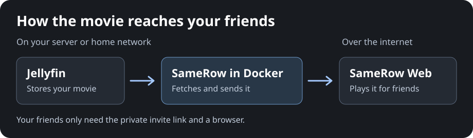
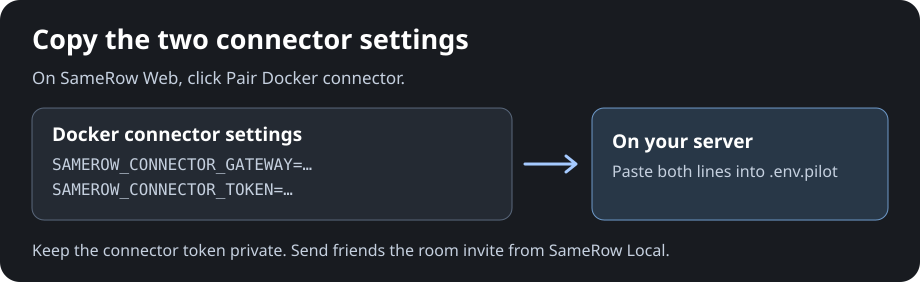

# Watch Jellyfin with friends over the internet

You run Jellyfin at home. Your friends open a SameRow link in their browser.
**Only you install Docker and sign in to Jellyfin.** A room fits you and up to
three friends. You start the room and control the movie from SameRow Local.

The connector is a small part of SameRow that runs in Docker next to Jellyfin.
It calls SameRow over the internet and fetches the movie from Jellyfin when
someone in your room presses play. Keep the server on while you watch. You
don't need to open a port on your router.



## 1. Get Docker and download SameRow

Open a terminal **on your Jellyfin server**, or connect to it with SSH. You can
also use another computer that can reach Jellyfin. If you already run Jellyfin
in Docker, check whether Compose is installed before installing anything.

Follow [Install Docker on your server](local-edition.md#install-docker-on-your-server).
Then run these two lines in the server terminal:

```sh
git clone https://github.com/devpratyushh/Samerow-V2.git
cd Samerow-V2
```

If you already downloaded SameRow, open that folder. Keep using this terminal
for the commands below.

## 2. Start SameRow on your server

Already running SameRow Local at `http://localhost:8080`? Rebuild it with
your existing Compose command and skip to step 3. The connector uses the
Jellyfin address you already configured.

For a new install, create a file named `.env.local-docker` with this line.
If Jellyfin runs on another machine, use its LAN address and port.

```dotenv
JELLYFIN_ALLOWED_ORIGINS=http://host.docker.internal:8096
```

Run:

```sh
docker compose --env-file .env.local-docker -f compose.local.yaml up --build -d
```

If Docker says you don't have permission, use `sudo docker compose` on Linux.
For a different port or a Jellyfin base path, see
[which address to use](local-edition.md#1-choose-your-jellyfin-address).

## 3. Connect once, then invite friends

1. Open [SameRow Local](http://localhost:8080/) and click **Host for friends
   online**.
2. The first time, click **Connect to SameRow Web** and approve the connection.
   If prompted, sign in with Google. SameRow returns you to the Docker app and
   saves the connection automatically.
3. Enter your name and click **Enter room**. SameRow fills in the private room
   code for you.
4. Click **+ → Your Jellyfin library**. Sign in to Jellyfin or use Quick
   Connect, then choose a movie. If your server uses a path such as
   `/jellyfin`, enter the full address under **Use a different Jellyfin address**
   when connecting the Docker app.
5. Click **Invite friends** and send the **whole link**. Your friends open it,
   enter a name, and click **Enter room**.

Next time, click **Host for friends online** to go straight to the room setup.
Use **Stop movie for everyone** when you're done.

If Docker runs on another machine, open a terminal **on the computer where you
watch** and run this command with your server's SSH username and address.
Keep the terminal open while you use [SameRow Local](http://localhost:8080/).

```sh
ssh -N -L 8080:127.0.0.1:8080 your-user@your-server
```

### Host from SameRow Web

A LAN-only installation can still use the older web-hosted workflow. Sign
in to SameRow Web with Google and click **Pair Docker connector**. Add the
two settings from the panel and `SAMEROW_CONNECTOR_JELLYFIN_URL` to your
Compose settings. Restart Docker. On SameRow Web, generate a private room,
then enter the Jellyfin address shown in the pairing panel.



## If it doesn't work

| What you see | What to do |
| --- | --- |
| **Host for friends online** is missing | Rebuild your Docker app and open `http://localhost:8080`. A LAN-only installation needs the web-hosted option above or a separate local Docker app bound to localhost. |
| The connection has expired | Open **Host for friends online** and approve a new connection. Saved connections expire after 30 days without online hosting. |
| The movie buffers | Try **Auto** or a lower quality, or test with fewer guests. Your home upload carries a separate stream for each viewer. |

## Technical details for SameRow operators

The connector makes outbound HTTPS requests to the Render media service. The
media service checks room access and passes each request to the connector,
which fetches the media from Jellyfin. The private invite has a separate secret
from the room code. Four streams at 8 Mbps each can use about 32 Mbps of the
host's upload.

If you run your own SameRow Web deployment, follow the
[production setup](production.md#configure-services). Use one media replica and
shared Redis, set `MAX_ROOM_SIZE=4` and `JELLYFIN_RELAY_ENABLED=true` on both
Render services, and check `/health/ready` on both. The control service's
`/api/config` should report `"maxRoomSize": 4` and `"jellyfinRelay": true`.
Use matching versions of the Docker app and both Render services. To use your
own deployment, set `SAMEROW_HOSTED_CONTROL_URL` to the control service origin
and `SAMEROW_HOSTED_WEB_ORIGIN` to the guest website origin in your Docker
settings file. Keep the online host app bound to `127.0.0.1:8080`.
