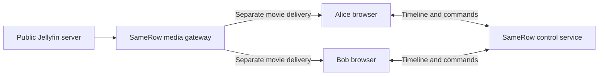
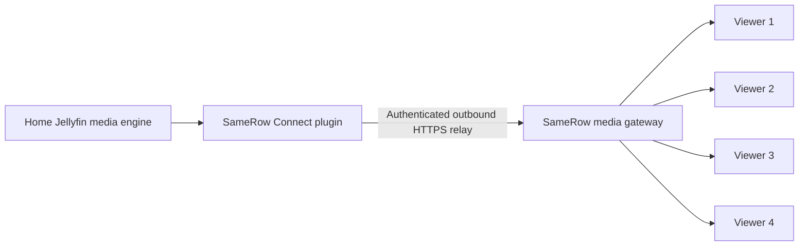

# Movie delivery and quality

See [SameRow V3 direct media](direct-media.md) for the opt-in plugin sender,
WebRTC delivery and HTTPS fallback. The gateway diagrams below describe the
HTTPS transport.

This describes the repository implementation. Deployment configuration defines
the intended hosted topology; verify the running revision and environment before
assuming a hosted installation matches it.

## What is the SameRow media gateway?

The gateway is SameRow's own Node.js/Express backend running the media role.
It authenticates viewer requests, restricts them to the room's selected movie,
requests media from Jellyfin, and streams the response bytes to the viewer.
It also proxies the scoped embedded Jellyfin Web player and rewrites playlists
so subsequent segment requests stay behind viewer access checks.

It is an application service, separate from the LiveKit service used for calls.
Jellyfin's media engine performs remuxing and transcoding. The gateway forwards
media; it does not encode the movie itself or distribute it through a CDN cache.

The repository's `render.yaml` defines:

| Service | Purpose |
| --- | --- |
| `samerow-v2`, `SERVICE_ROLE=control` | Room membership, signaling, shared playback and chat; two instances configured |
| `samerow-media`, `SERVICE_ROLE=media` | Jellyfin APIs, scoped movie delivery and outbound connector relay; one instance configured |
| `samerow-state` | Redis shared state, credentials, leases and delivery counters |
| External LiveKit service | Hosted camera, microphone and screen tracks |

Both Node services use `SameRow/server`, `npm start`, and the same application
code. `MEDIA_PUBLIC_URL` supplies the media gateway's public HTTPS origin; its
actual deployed address is environment configuration, not fixed in the source.
The Render blueprint specifies a Starter plan for each Node service; it does not
establish a measured sustainable movie bandwidth capacity.

## Public Jellyfin address: two web viewers

The host signs in and selects a movie. SameRow creates a shared playback session
and a separate scoped access token for each viewer. Each browser requests its
own playlist, segments or byte ranges through the gateway. A public Jellyfin
address makes the server reachable by the gateway; browsers still use the
scoped gateway in this implementation. The host browser does not forward movie
bytes to the guest, and the guest does not receive the owner's Jellyfin token.

## Home Jellyfin with SameRow Connect

The plugin runs on the Jellyfin server. Viewers use SameRow Web.

## Four viewers: bandwidth and encoding

Each viewer, including the host when watching, has a separate logical media
delivery. The current relay does not upload one shared movie copy and fan it out.

| Bitrate per viewer | Approximate origin upload for four viewers |
| --- | --- |
| 4 Mbps | 16 Mbps |
| 8 Mbps | 32 Mbps |
| 20 Mbps | 80 Mbps |

Allow additional bandwidth for peaks, protocol overhead, calls and retries.
Prefetching means instantaneous throughput can exceed the movie's bitrate.
The gateway needs aggregate inbound and outbound capacity too. A plugin on a
home server consumes that home's upload bandwidth.

Four viewers do not necessarily require four video transcodes. Compatible
viewers can receive stream-copy video. Different quality, audio, subtitles and
device support can require separate Jellyfin playback/transcoding sessions;
do not assume identical requests share an encoder or cached delivery.

## Quality is personal to each viewer

| Mode | Behavior |
| --- | --- |
| Original | Requests source video stream-copy where supported and within configured capacity; repackaging or audio conversion may still occur |
| Auto | Allows compatible playback and adapts to connection conditions |
| 4, 8 or 20 Mbps | Caps requested bitrate on that viewer; Jellyfin may re-encode |

The regular SameRow player currently defaults to Original. The embedded Jellyfin
Web player defaults to Auto unless the viewer has selected a mode. Both apply
server quality policy, but their playback/adaptation mechanisms differ.

Quality depends on source bitrate/resolution, browser codec support, selected
audio, subtitles, available throughput and decoding capacity. Text subtitles
can overlay the picture. Subtitles requiring burn-in force video conversion.
Original can fall back to compatible playback when unsupported or unable to
keep up; SameRow displays the fallback reason. In the regular player, persistent
buffering can lower the requested compatible bitrate based on an HLS throughput
estimate. This is not a guarantee of source quality or automatic recovery to the
highest quality in every player.

Optional `JELLYFIN_ORIGIN_BANDWIDTH_MBPS` and
`JELLYFIN_GATEWAY_BANDWIDTH_MBPS` configure sustainable bandwidth budgets.
SameRow reserves 20% headroom, divides the configured capacity among active
viewer leases, and applies the narrower origin/gateway allowance along with the
viewer mode and source allowance. Redis shares leases across rooms/replicas.
For example, a 40 Mbps origin budget with four active viewers yields an 8 Mbps
allowance each before other limits. Zero/unset means no configured capacity
limit; these settings do not measure the internet plan automatically.

## Shared timeline, separate streams

The control service distributes the selected item, playing state, position,
timestamp and revision. Each browser buffers and decodes its own stream and
corrects playback drift. Audio, subtitles, volume and quality remain personal.
Shared play/pause/seek commands update the common timeline.

## Why local pictures can blur

Camera capture requests 1080p at 30 FPS and is never reduced by room size.
High quality is the default, allowing up to 4 Mbps per camera receiver and
6 Mbps per screen receiver. LiveKit uses the same top-layer ceilings with
simulcast and adaptive subscriptions. Actual resolution depends on hardware
and browser congestion control.

For calls, optional Balanced mesh mode divides a fixed upload budget among receivers
and lowers cameras to 320×180 at four participants, even on fast Wi-Fi. Select
High quality in Stats for nerds on each sending device to allow 1080p
cameras and 1080p screen sharing. CPU and congestion can still reduce quality.

That camera policy does not affect Jellyfin movies. Movie blur can result from
transcoding, bitrate caps, adaptive fallback or the source itself. Local viewers
using a hosted gateway still depend on the hosted route. Original requests
stream-copy where supported, but cannot override browser compatibility or
configured shared capacity.

## Reading Stats for nerds

Open More options → Stats for nerds. Call metrics describe this device's links:
bitrate, resolution, FPS, codec, loss, jitter and available encoder/RTT reports.
For an SFU room, uploads go to LiveKit rather than directly to each viewer.

## Implementation references

- [Deployment topology](../render.yaml)
- [Backend roles and routing](../SameRow/server/application.js)
- [Movie session and segment gateway](../SameRow/server/jellyfin.js)
- [Scoped Jellyfin Web proxy](../SameRow/server/jellyfinWeb.js)
- [Connector relay](../SameRow/server/jellyfinRelay.js)
- [Native connector service](../jellyfin-plugin-samerow/Services/SameRowConnectorService.cs)
- [Quality policy](../SameRow/server/jellyfinQuality.js)
- [SameRow movie player](../SameRow/client/src/JellyfinPlayer.jsx)
