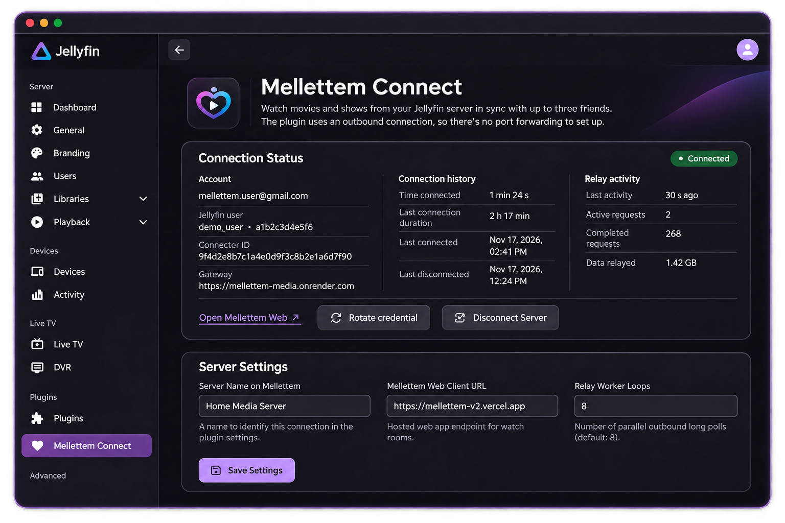

# Install and connect Mellettem Connect

Mellettem Connect is the Jellyfin server plugin that securely links your home library with Mellettem. It opens an **outbound HTTPS connection** to Mellettem, so you do not need to forward router ports, publish your Jellyfin address, or ask friends to install anything.

The paired plugin can deliver movie resources directly over WebRTC on supported browsers. Playback uses HTTPS fallback when a browser or network cannot use the direct path. Your Jellyfin server and internet connection must stay online during a watch party.

> **Compatibility:** Mellettem Connect 1.0.8.0 is a public beta built for **Jellyfin 12.3 and .NET 10**. Other Jellyfin versions have not been validated. The project provides this third-party plugin catalog; Mellettem Connect is not listed in Jellyfin's default catalog.

## Install from the plugin catalog

1. Sign in to Jellyfin with an administrator account and open **Dashboard → Plugins → Repositories**.
2. Add a repository named **Mellettem Connect** with this catalog URL:

   ```text
   https://raw.githubusercontent.com/devpratyushh/Samerow-V2/main/jellyfin-plugin-samerow/manifest.json
   ```

3. Save the repository, open **Catalog**, and install **Mellettem Connect**. Refresh the catalog if it does not appear immediately.
4. Restart Jellyfin when installation finishes.
5. Open **Dashboard → Plugins → Mellettem Connect**.



*Illustrative plugin settings preview. Your dashboard displays your server’s live connection status and relay activity.*

## Link your server to your Google account

1. In Jellyfin's Mellettem Connect settings, select **Connect Mellettem**.
2. The plugin displays an approval link. Open it and sign in to Mellettem with Google.
3. Approve the server connection in Mellettem Web.
4. Return to Jellyfin and wait for the plugin status to show **Connected**.

The plugin reaches Mellettem through an outbound secure connection. Leave Jellyfin running, but you can close its dashboard after pairing.

## Start a Jellyfin watch party

1. Open [Mellettem Web](https://samerow-v2.vercel.app/) and sign in to the same Google account that approved the server.
2. Create a private room and invite your friends.
3. Open **Share something → Your Jellyfin library** and choose the connected server.
4. Sign in to Jellyfin or use **Quick Connect**, then choose a movie.
5. Approve your friends' join requests. They can watch in their browsers without installing the Jellyfin plugin.

Everyone follows the room's play, pause, and seek timeline. Each person can choose their own available audio track, subtitles, volume, and quality. The hosted pilot supports one host and up to three friends.

## Troubleshooting

- **The plugin does not appear in Catalog:** confirm the server is running Jellyfin 12.3, save the repository URL, refresh the catalog, and restart Jellyfin after installation.
- **The connection does not reach Connected:** check outbound HTTPS access from the Jellyfin server, confirm you approved the request in the intended Google account, and try **Connect Mellettem** again.
- **The server is missing from Mellettem:** verify you signed into Mellettem using the same Google account that approved pairing. Check that Jellyfin is still online.
- **Direct playback is unavailable:** supported browsers and networks use WebRTC; other browser or network conditions use HTTPS fallback. Select Auto or a bitrate limit if the source is too demanding for your connection.
- **You need help:** see the [full plugin guide](../jellyfin-plugin-mellettem/README.md), [playback and network notes](direct-media.md#validation), or [report an issue](https://github.com/devpratyushh/Samerow-V2/issues).

[Back to the project README](../README.md) · [Plugin releases](https://github.com/devpratyushh/Samerow-V2/releases)
